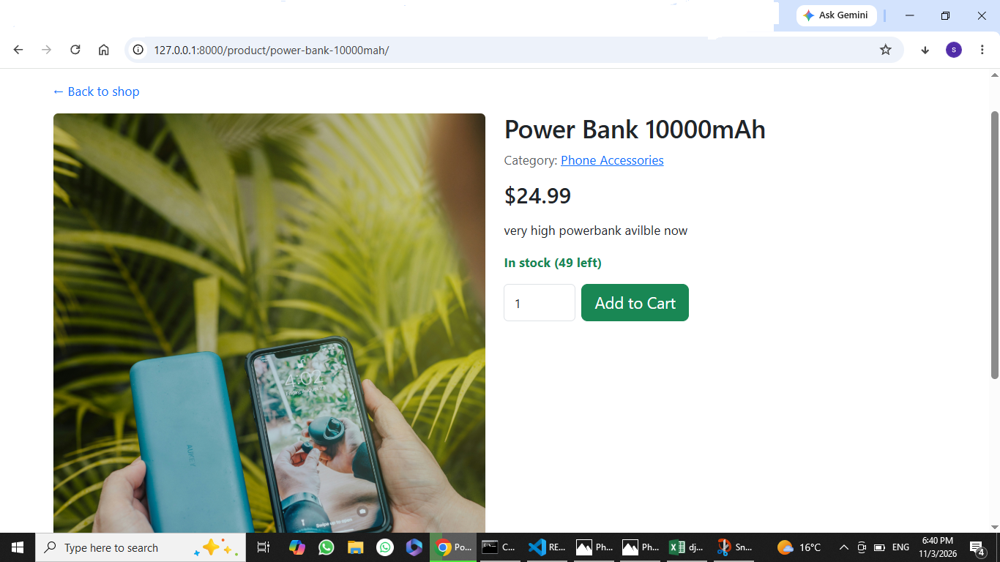
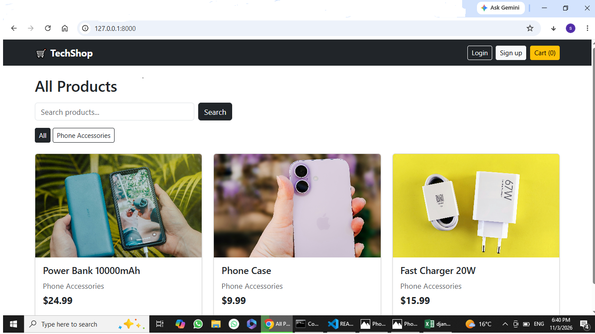
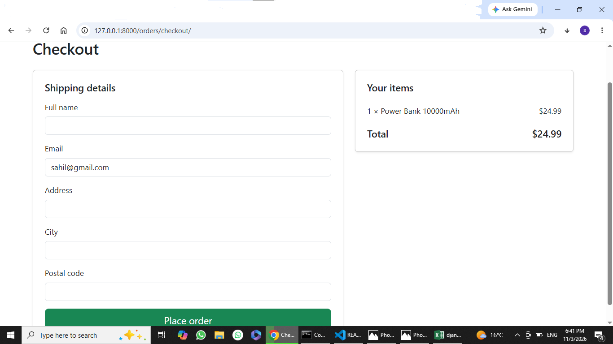

# TechShop - Django E-Commerce Store

A full-stack online store for tech accessories, built with Django.

## Features
- Product catalog with categories, images and stock
- Search and category filtering
- Session-based shopping cart (add, update quantity, remove)
- User signup, login and logout
- Checkout with shipping details, saved as orders
- Simulated card payment (Stripe-style test mode, no real money)
- Order history and order detail pages
- Admin panel to manage categories, products and orders

## Tech stack
Python, Django, SQLite, Bootstrap 5, HTML/CSS, Git

## How to run
1. Clone the repo
   `git clone https://github.com/shawkatsahil/ecommerce-django.git`
2. Create and activate a virtual environment
   `python -m venv venv` then `venv\Scripts\activate`
3. Install the requirements
   `pip install -r requirements.txt`
4. Create a `.env` file with `SECRET_KEY='any-long-random-text'`
5. Set up the database
   `python manage.py migrate`
6. Create an admin user
   `python manage.py createsuperuser`
7. Start the server
   `python manage.py runserver`
8. Add categories and products in the admin at `/admin`

## Demo payment
Payments are simulated. Use the test card `4242 4242 4242 4242` with any expiry and CVC.
Other card numbers are declined. Never enter a real card.

## Screenshots

## Future improvements
- Real payment gateway
- PostgreSQL and Docker
- Automated tests
- Deployment

## Author
Sahil